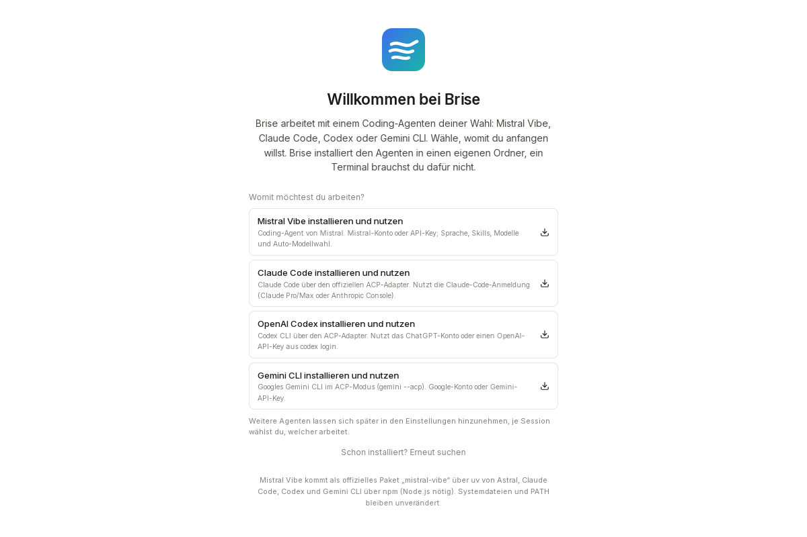

<div align="center">


# Brise

**Desktop-Client für KI-Coding-Agenten, gebaut für Zusammenarbeit im kleinen Team und für Power-User.**
Arbeitet mit Mistral Vibe, Claude Code, Codex und Gemini CLI. Für Windows, macOS und Linux.

[](https://github.com/magro07/brise/actions/workflows/build.yml)

</div>


Brise ist ein privates Open-Source-Projekt (Apache-2.0). Es führt keinen eigenen
Agenten aus, sondern steuert vorhandene Agenten über das
[Agent Client Protocol](https://agentclientprotocol.com) (ACP). Du nutzt also deine
bestehende Anmeldung bzw. dein Abo beim jeweiligen Anbieter. Worauf das Projekt
hinauswill, steht in [docs/positionierung.md](docs/positionierung.md).

> Brise ist ein unabhängiges Projekt und mit keinem der Anbieter verbunden.
> „Mistral“, „Vibe“, „Claude“, „Codex“ und „Gemini“ sind Marken ihrer Inhaber.

## Zusammenarbeit

- **Sessions teilen:** Ein Einladungslink öffnet die Session bei anderen. Sie sehen
  Konversation und Diffs live mit. Wer Mitarbeiter ist, schlägt Prompts vor, wer
  Freigeber ist, entscheidet Freigaben. Der Agent läuft dabei nur beim Host.
- **Teams:** Wer online ist, welche Sessions geteilt sind (ein Klick zum Beitreten),
  welche Abos es gibt, dazu eine gemeinsame Projektliste.
- **Gastzugang auf dem eigenen Abo:** Der Host legt fest, ob Gäste Prompts auf
  sein Abo schicken dürfen, optional mit Tageslimit für Prompts oder Tokens je Gast.
  Die Nutzung je Gast steht im Teilen-Dialog.
- **Ende-zu-Ende verschlüsselt** (XChaCha20-Poly1305, Rollen signiert der Host mit
  Ed25519). Im selben Netz verbindet Brise direkt, für Gäste von außerhalb gibt es
  ein kleines [Relay zum Selbst-Hosten](relay/README.md), etwa im Homelab
  (Docker Compose, Beispiel für Caddy). Das Relay sieht keine Inhalte.

Protokoll und Sicherheitsmodell: [docs/collab-protocol.md](docs/collab-protocol.md).

## Mehrere Agenten

| Agent | Anmeldung | Was Brise zusätzlich kann |
|---|---|---|
| [Mistral Vibe](https://github.com/mistralai/mistral-vibe) | Mistral-Konto im Browser, Vibe-Key oder API-Key | Installation ohne Terminal, Einstellungen aus Vibes Schema, Modelle, Skills, Auto-Modellwahl, Sprache |
| [Claude Code](https://docs.anthropic.com/claude-code) | Claude-Code-Anmeldung (Pro/Max oder Console) | Anmeldung aus Brise heraus |
| [Codex](https://github.com/openai/codex) | `codex login` oder `OPENAI_API_KEY` | |
| [Gemini CLI](https://github.com/google-gemini/gemini-cli) | Google-Konto oder `GEMINI_API_KEY` | |

- Jede Session gehört einem Agenten, gewählt beim Anlegen. Ein Badge an Session
  und Tab zeigt, welcher es ist.
- Beim ersten Start wählst du, womit du anfängst. Keiner der Agenten ist Pflicht:
  Wer kein Vibe hat, startet genauso mit Claude Code oder Codex. Brise installiert
  die ACP-Adapter (`claude-agent-acp`, `codex-acp`) per npm in den eigenen
  Datenordner, Vibe per `uv`.
- Freigaben, Diffs, Aufgabenliste, Slash-Befehle und Sessions-Liste kommen bei allen
  Agenten über Standard-ACP. Was nur Vibe bietet, blendet Brise bei den anderen aus.

## Für Power-User

- **Master-Session:** Eine Session plant die Arbeit, schlägt Teilaufgaben als Karten
  vor und startet sie als eigene Sessions in eigenen Git-Worktrees, gern mit anderem
  Agenten oder Modell. Sie bekommt eine Notiz, sobald eine fertig ist, prüft das
  Ergebnis und merged nach deiner Freigabe.
- **Model Council:** Der Agent holt sich bei Reviews, Fehlersuche oder „ist das
  wirklich fertig?“ zweite Meinungen von anderen Modellen. Die Urteile erscheinen
  als Karte im Chat, mit Kosten und Tageslimit.
- **Eigene Benchmarks:** Aufgaben mit Prüfungen (Befehl, Regex, Datei, Richtermodell)
  gegen mehrere Agenten und Modelle laufen lassen, in isolierten Arbeitsordnern.
  Eine Vergleichstabelle und der Verlauf je Ziel zeigen Regressionen.
- **Secrets:** Passwörter und Tokens gibst du in ein eigenes Feld ein, nie in den
  Chat. Der Wert liegt nur im Schlüsselbund, der Agent sieht einen Platzhalter.
  Versehentlich eingetippte Schlüssel erkennt Brise vor dem Senden.
- **Auto-Modellwahl (Vibe):** Ein kleines Task-Modell stuft jede Aufgabe ein und
  setzt Modell bzw. Denkstufe. Jeder Wechsel ist mit Begründung nachlesbar.
- **Nutzung und Leistung:** Journal jedes Aufrufs mit Tokens, Kosten, Projekt und
  Backend, Monatsbudget mit Prognose. Dazu Zeit bis zum ersten Token und t/s je
  Modell als Median und p90.
- **Daten ohne Speicherung beim Anbieter:** Über [Cortecs](https://cortecs.ai)
  laufen Modelle mit Zero Data Retention. Brise prüft Prompts vor dem Senden auf
  sensible Daten (IBAN, Schlüssel, Gesundheitsdaten …) und schlägt dann ein ZDR-Modell vor.
- **Selbst hosten:** Relay im eigenen Netz, keine Brise-Cloud, Brise selbst sendet keine Telemetrie.

## Arbeiten mit Brise

- Projekte mit ihren Sessions in der Seitenleiste, Befehlspalette (Strg/⌘+K), Hell-
  und Dunkelmodus. **Tabs und geteilte Ansicht** mit bis zu drei Bereichen nebeneinander.
- Live-Streaming mit zusammengefassten Werkzeugaufrufen, Diffs, Gedankengang,
  Subagent-Karten und Aufgabenliste. Freigaben direkt über dem Eingabefeld.
  „Immer erlauben“ gibt es nur mit Befehlsmuster.
- `@` hängt Dateien an, `/` ruft Befehle und Skills auf, Bilder per Drag & Drop.
- **Werkzeuge:** Terminal mit echter Shell, Git (vormerken, Commit mit KI-Nachricht,
  Pull, Push, Verlauf), Monaco-Editor mit Vergleich zum letzten Commit,
  „Öffnen in“ für VS Code, Cursor, Zed und andere.
- **Kontext-Aufschlüsselung:** wofür der Kontext draufgeht, bis zu den größten Einzelposten.
- **Semantische Codesuche** mit `codestral-embed`, im Panel und als Werkzeug für den Agenten.
- **Design-Modus:** Chat mit Live-Vorschau, Varianten, Versionen und Design-Tokens.
  Die Übergabe startet eine Coding-Session mit Auftrag.
- **3D-Modus:** 3D-Modelle als Code (three.js, optional OpenSCAD oder Blender) mit
  eingebautem Viewer, Maßen, Reglern, Teileauswahl, Varianten und Versionen; Übergabe als
  glTF oder STL mit Einbindungsauftrag.
- **Code, Design und 3D vernetzt:** Jede Session liest Designs und Modelle samt Vorschaubild
  (`read_design`, `read_model`), übernimmt sie ins Projekt und delegiert neue an eine
  Design- bzw. 3D-Session (`start_session` mit `mode`).
- **Personalisierte Vorschläge** auf der Startseite aus README, Git-Stand, TODOs und
  den letzten Sessions.
- **Sprache (über Vibe):** Spracheingabe mit Voxtral Realtime, Vorlesen mit Voxtral TTS.
- **Brise per Chat anpassen:** „Mach Brise orange“, „Leg eine Schnellaktion
  ‚Release vorbereiten‘ an“. Der mitgegebene MCP-Server `brise-app` ändert
  Einstellungen, CSS und Schnellaktionen, Brise übernimmt das sofort.

**Mitgelieferte Skills:** [reverse-engineer-anything](https://github.com/morluto/rea),
[ponytail](https://github.com/DietrichGebert/ponytail),
[gauntlet-loop](https://github.com/duolahypercho/gauntlet-loop), frontend-design,
webapp-testing, mcp-builder und skill-creator ([anthropics/skills](https://github.com/anthropics/skills)),
dazu `brise-anpassen`, `council`, `deep-research`, `design-mode` und `3d-mode`. Lizenzen und Quellen:
[NOTICE.md](app/src-tauri/resources/skills/NOTICE.md).

## Neu in 0.4

- **Einfacher Modus:** Einstellungen → Allgemein blendet alles aus, was man zum Loslegen nicht braucht.
- **Tastenkürzel:** Alle Aktionen sind frei belegbar, mit Tastenfolgen, Konfliktanzeige, Import und Export. Denkstufe rauf und runter, Tabs per `Strg+Alt+1…5`, Spracheingabe zum Halten.
- **YouTube-Links:** Ein Link im Prompt bringt Titel, Beschreibung und Transkript automatisch mit, bei jedem Agenten.
- **Goals:** `/goal <Ziel>` lässt den Agenten bis zu zehn Runden weiterarbeiten, bis das Ziel erreicht ist.
- **Automationen:** Tägliche Aufträge unter Einstellungen → Werkzeuge. Brise muss dafür geöffnet sein.
- **Roblox Studio:** Brise bindet den MCP-Server automatisch ein. In Studio muss „Enable Studio as MCP server“ an sein.
- **Lokale Transkription:** Brise schickt die Aufnahme an einen eigenen OpenAI-kompatiblen Server, voreingestellt `parakeet-tdt-0.6-v3`. Einen eingebauten Modell-Download gibt es noch nicht.
- **Websuche** mit Vibe läuft ohne Rückfrage.

## Bilder

| Startseite mit persönlichen Vorschlägen | Freigabe, Diff und Aufgabenliste |
|---|---|
|  |  |
| **Erster Start: Agent wählen** | **Modelle und Auto-Wahl (Vibe)** |
|  |  |
| **Editor mit Vergleich zum letzten Commit** | **Terminal** |
|  |  |

## Installieren

Fertige Installer gibt es unter [Releases](https://github.com/magro07/brise/releases):

| System | Datei |
|---|---|
| Windows 10/11 | `.msi` oder `-setup.exe` |
| macOS 11+ (Apple Silicon und Intel) | `.dmg` |
| Linux | `.AppImage`, `.deb` oder `.rpm` |

Die Builds sind nicht signiert. Windows SmartScreen und macOS Gatekeeper warnen
deshalb beim ersten Start. Unter macOS öffnest du Brise dann per Rechtsklick → „Öffnen“.

Update unter Windows mit einem Befehl in PowerShell:

```powershell
irm https://raw.githubusercontent.com/magro07/brise/main/scripts/update.ps1 | iex
```

Schon installierte Agenten findet Brise von selbst. Für Claude Code, Codex und
Gemini braucht es Node.js 22 oder neuer.

## Entwickeln

```bash
cd app
npm install
npm run tauri dev              # Entwicklungsmodus
npm run tauri build            # Installer bauen
./src-tauri/target/release/brise --self-test   # Selbsttest ohne Fenster
```

Voraussetzungen für Tauri findest du unter [tauri.app/start/prerequisites](https://tauri.app/start/prerequisites/).
Unter Linux brauchst du zusätzlich die ALSA-Header (`libasound2-dev` bzw. `alsa-lib-devel`).

Bei jedem Push baut die [CI](.github/workflows/build.yml) Brise auf Windows, macOS und
Linux und lässt dort `--self-test` laufen: Installation von uv und Vibe, Start der
Agenten über ACP, die MCP-Server, Terminal und Git.

Architektur und Details zu jeder Funktion: [app/README.md](app/README.md).
Entscheidungen: [docs/adr/](docs/adr/). Fahrplan: [PLAN.md](PLAN.md).

### Aufbau in Kürze

```
Brise (Tauri 2: Rust + React)
 ├─ Oberfläche: React, Tailwind, Radix, Monaco, xterm.js
 ├─ Rust: ACP-Client, Installer, Git, Terminal, Embeddings, Nutzung, Benchmarks
 ├─ MCP-Server in Brise: brise-app (Anpassung, Secrets), brise-search, brise-council
 ├─ Kollaboration: E2E-verschlüsselt, direkt im LAN oder über relay/ (selbst gehostet)
 └─ startet per ACP ──► vibe-acp · claude-agent-acp · codex-acp · gemini --acp
```

## Lizenz

[Apache-2.0](LICENSE). Mitgelieferte Skills behalten ihre eigenen Lizenzen (MIT bzw. Apache-2.0).
