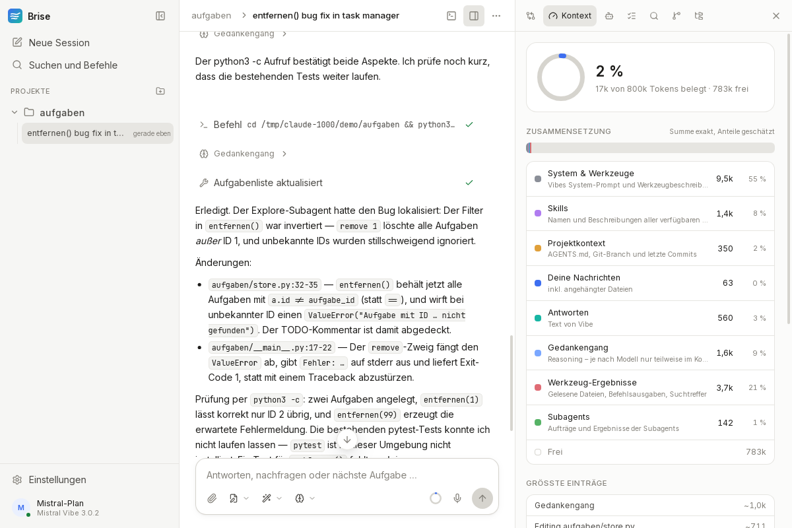
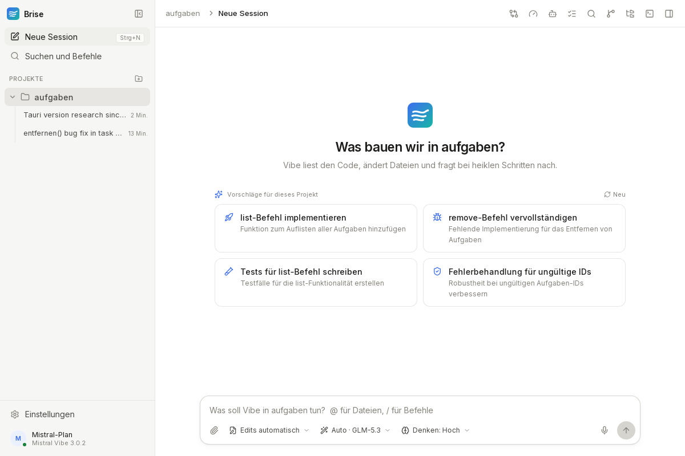
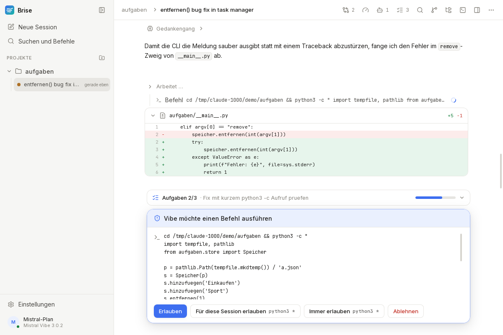
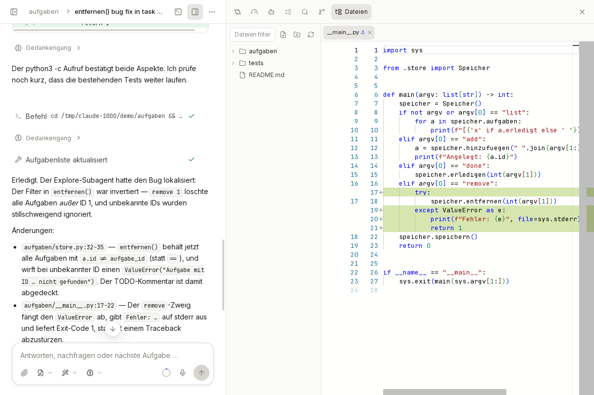
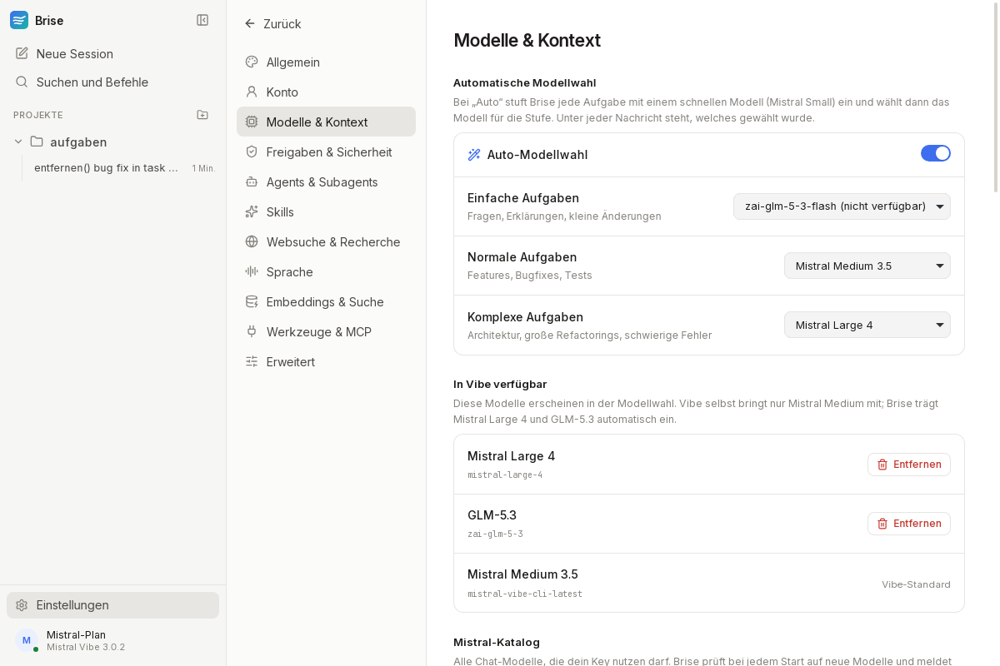
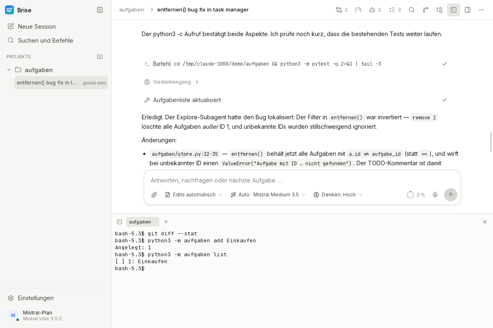
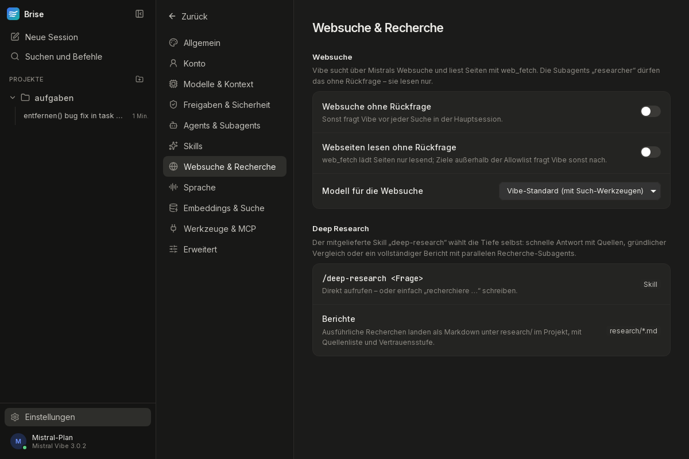

<div align="center">


# Brise

**Die Desktop-App für [Mistral Vibe](https://github.com/mistralai/mistral-vibe), angelehnt an Claude Code und Codex.**
Für Windows, macOS und Linux. Du brauchst weder Terminal noch API-Key, dein Mistral-Plan genügt.

[](https://github.com/magro07/brise/actions/workflows/build.yml)

</div>



> Brise ist ein unabhängiges Projekt und nicht mit Mistral AI verbunden. „Mistral“ und „Vibe“ sind Marken ihrer Inhaber.

## Was Brise kann

**Einfach loslegen**
- Beim ersten Start installiert Brise Mistral Vibe selbst in einen eigenen Ordner. Dafür nutzt es das offizielle `uv` und prüft dessen Prüfsumme.
- Anmeldung mit dem Mistral-Konto im Browser (Kontingent des Vibe-Plans) oder per eingefügtem Vibe-Key bzw. API-Key.
- Personalisierte Vorschläge: Brise liest README, Git-Stand, letzte Commits, TODOs und deine letzten Sessions und schlägt konkrete nächste Aufgaben vor.

**Arbeiten wie in Claude Code und Codex**
- Projekte mit ihren Sessions in der Seitenleiste, Befehlspalette (Strg/⌘+K), Hell- und Dunkelmodus.
- Live-Streaming mit zusammengefassten Werkzeugaufrufen, Diffs, Gedankengang, Subagent-Karten und einer Aufgabenliste mit Fortschritt.
- Freigaben direkt über dem Eingabefeld. „Immer erlauben“ gibt es nur mit Befehlsmuster, Passwörter werden maskiert.
- `@` hängt Dateien an, `/` ruft Befehle und Skills auf. Bilder per Drag & Drop.
- **Auto:** GLM-5.3 arbeitet, und das Task-Modell (Mistral Small, wählbar) setzt die Denkstufe:
  - Vor jeder Anfrage stuft es die Aufgabe ein.
  - Während der Arbeit steuert es nach, etwa höher bei wiederholten Fehlern und niedriger bei reinem Lesen.
  - Ein Klick auf die Denkstufe zeigt jeden Wechsel mit Begründung.
  - Alternativ wechselt Auto das Modell je nach Aufgabe.
- **Tabs und geteilte Ansicht:** mehrere Sessions als Tabs, bis zu drei Bereiche nebeneinander, jeder mit eigenem Eingabefeld. Kürzel: Strg/⌘+W, Strg+Tab, Strg/⌘+\.
- **Modelle:** Mistral Large 4 und GLM-5.3 sind sofort dabei. Bei jedem Start meldet Brise neue Modelle aus Mistrals Katalog, eigene lassen sich hinzufügen.

**Werkzeuge**
- Eingebautes **Terminal** mit echter Shell, mehreren Tabs und Strg/⌘+ö.
- **Git:** Branches, Änderungen vormerken, Commit mit KI-Nachricht, Pull und Push, Verlauf. Unter Windows bringt Brise Git bei Bedarf selbst mit.
- **Editor:** Monaco, der Editor von VS Code, mit Datei-Explorer und Vergleich zum letzten Commit. „Öffnen in“ für VS Code, Cursor, Zed und andere.
- **Detaillierte Kontext-Aufschlüsselung:**
  - System und Werkzeuge, Skills, Projektkontext
  - deine Nachrichten, Antworten, Gedankengang
  - Werkzeug-Ergebnisse, Subagents, freier Platz
  - die größten Einzelposten
- **Semantische Codesuche** mit `codestral-embed`, für dich im Panel und für Vibe als Werkzeug.
- **Websuche bis Deep Research:**
  - Vibe sucht nativ im Web.
  - Der Skill `deep-research` zerlegt Fragen in Teilfragen und lässt Subagents parallel recherchieren.
  - Er prüft Quellen gegeneinander und schreibt bei Bedarf einen belegten Bericht nach `research/`.
- **Weitere Mistral-Modelle:**
  - Codestral vervollständigt im Editor wie Copilot.
  - Mistral OCR liest angehängte PDF-, Word- und PowerPoint-Dateien.
  - Das Task-Modell (wählbar) stuft Aufgaben ein.
- **Neue Projekte** legst du direkt in der App an, mit Git und README. Beim ersten Start führt eine Tour durch alle Bereiche.
- **Sprache:** Spracheingabe mit Live-Wellenform und Wort-für-Wort-Transkript (Voxtral Realtime), Vorlesen von Antworten (Voxtral TTS).

**Skills, die mitkommen**

[reverse-engineer-anything](https://github.com/morluto/rea) (rea, mit MCP-Werkzeugen), [ponytail](https://github.com/DietrichGebert/ponytail) (sechs Skills), [gauntlet-loop](https://github.com/duolahypercho/gauntlet-loop), frontend-design, webapp-testing, mcp-builder und skill-creator ([anthropics/skills](https://github.com/anthropics/skills)), dazu der eigene Skill `brise-anpassen`. Lizenzen und Quellen stehen in [NOTICE.md](app/src-tauri/resources/skills/NOTICE.md).

**Brise per Chat anpassen**

Sag Vibe einfach, was du an Brise ändern willst. Zum Beispiel:
- „Mach Brise orange und die Schrift etwas größer.“
- „Nimm für komplexe Aufgaben immer Mistral Large 4.“
- „Leg eine Schnellaktion ‚Release vorbereiten‘ an.“
- „Versteck den Gedankengang.“

Brise gibt jeder Session dafür den MCP-Server `brise-app` mit. Über dessen Werkzeuge ändert Vibe Einstellungen, eigenes CSS, Schnellaktionen und Vibes `config.toml`, und Brise übernimmt das sofort.

## Bilder

| Startseite mit persönlichen Vorschlägen | Freigabe, Diff und Aufgabenliste |
|---|---|
|  |  |
| **Editor mit Vergleich zum letzten Commit** | **Modelle und Auto-Wahl** |
|  |  |
| **Terminal** | **Websuche und Deep Research (dunkel)** |
|  |  |

## Installieren

Fertige Installer gibt es unter [Releases](https://github.com/magro07/brise/releases):

| System | Datei |
|---|---|
| Windows 10/11 | `.msi` oder `-setup.exe` |
| macOS 11+ (Apple Silicon und Intel) | `.dmg` |
| Linux | `.AppImage`, `.deb` oder `.rpm` |

Die Builds sind noch nicht signiert. Windows SmartScreen und macOS Gatekeeper warnen deshalb beim ersten Start. Unter macOS öffnest du Brise dann per Rechtsklick → „Öffnen“.

Brise findet ein schon installiertes Mistral Vibe von selbst. Sonst bietet die App beim ersten Start die Installation an.

## Entwickeln

```bash
cd app
npm install
npm run tauri dev              # Entwicklungsmodus
npm run tauri build            # Installer bauen
./src-tauri/target/release/brise --self-test   # Selbsttest ohne Fenster
```

Voraussetzungen für Tauri findest du unter [tauri.app/start/prerequisites](https://tauri.app/start/prerequisites/). Unter Linux brauchst du zusätzlich die ALSA-Header (`libasound2-dev` bzw. `alsa-lib-devel`).

Bei jedem Push baut die [CI](.github/workflows/build.yml) Brise auf Windows, macOS und Linux und lässt dort `--self-test` laufen. Geprüft werden:
- Installation von uv und Vibe
- Start von ACP
- beide MCP-Server
- Terminal und Git

Mehr zur Architektur steht in [app/README.md](app/README.md), Hintergründe und Fahrplan in [PLAN.md](PLAN.md).

### Aufbau in Kürze

```
Brise (Tauri 2: Rust + React)
 ├─ Oberfläche: React, Tailwind, Radix, Monaco, xterm.js
 ├─ Rust: ACP-Client, Installer, Git, Terminal, Embeddings, Mikrofonpegel
 ├─ MCP-Server in Brise selbst: brise-app (Anpassung), brise-search (Suche)
 └─ startet ──► vibe-acp (Mistral Vibe, Apache-2.0) ──► Mistral-API
```

## Lizenz

[Apache-2.0](LICENSE). Mitgelieferte Skills behalten ihre eigenen Lizenzen (MIT bzw. Apache-2.0).
